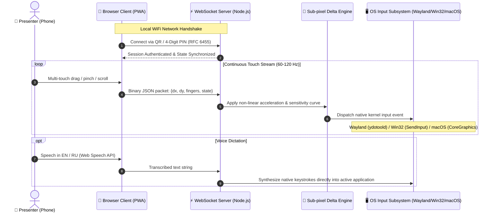

<div align="center">
  
</div>

<div align="center">

# 📱 MOUSet &mdash; Zero-Install Mobile Presentation Remote & Multi-Touch Trackpad

**Clean-room open-protocol mobile remote control system. Turn any smartphone (iPhone / Android) into an ultra-low latency presentation clicker, multi-touch trackpad, voice dictation assistant, and system volume controller.**

[](https://nodejs.org/)
[-010101?style=for-the-badge&logo=socketdotio&logoColor=white)](https://datatracker.ietf.org/doc/html/rfc6455)
[](https://github.com/Nekono3/mousely)
[](https://github.com/Nekono3/mousely)

</div>

---

## ⚡ 1-Line Instant Start

### 🪟 Windows (Run in PowerShell):
```powershell
irm https://raw.githubusercontent.com/Nekono3/mousely/main/install.ps1 | iex
```

### 🍎 macOS & 🐧 Linux (Run in Terminal):
```bash
curl -fsSL https://raw.githubusercontent.com/Nekono3/mousely/main/install.sh | bash
```

---

## 🏗 System Architecture & Protocol Flow



---

## ✨ Features

- 🌌 **Futuristic OLED Trackpad:** Radial glowing touch dot matrix on Canvas (60 FPS) with physical spring response and haptic feedback.
- 🖱️ **Multi-Touch Gestures:** Smooth 1-finger cursor movement, tap-to-click, and natural 2-finger reverse scrolling.
- 📜 **Adjustable Scroll Sensitivity:** Built-in sub-pixel scroll accumulator with an in-app sensitivity slider (`0.2x` to `3.0x`) for buttery-smooth control.
- 🎯 **Presenter Controls:** Slide back/forward chevrons (`‹` / `›`), fullscreen presentation start (`F5`), and quick exit (`Esc`).
- 🎙️ **Rapid Voice-to-Text Dictation:** Real-time speech recognition in English & Russian typing directly into active applications on your computer.
- ⌨️ **Live Keyboard Modal:** Real-time phone-to-PC typing with rapid backspace hold-to-delete sync.
- 🔊 **System Volume Controller:** Interactive volume capsule slider synced with OS master volume.
- 📱 **Instant Pairing:** 4-digit numeric PIN code + high-contrast QR code for instant pairing over WebSockets / HTTPS.
- 🔄 **Orientation Adaptive:** Responsive layout for both vertical (portrait) and horizontal (landscape) handheld modes.

---

## 🏛️ Clean-Room Design & Architecture

MOUSet is developed under strict **Clean-Room Design ("Chinese Wall") principles** to ensure 100% legal, copyright, and interoperability compliance:

1. **Independent Implementation:** Written from scratch using standard open W3C/IETF specifications (RFC 6455 WebSockets, HTML5 Canvas, Web Speech API).
2. **Zero Contamination:** This repository contains no proprietary code, no reverse-engineered binary dumps (`.exe`, `.dll`, `.ipa`, `.apk`), no intermediate disassembler databases, and no extracted commercial assets.
3. **Interoperability Rationale:** Developed under statutory interoperability provisions (US 17 U.S.C. § 1201(f) and EU Directive 2009/24/EC Article 6) to bridge mobile web browsers with standard desktop operating systems.
4. **Specification Document:** Complete functional interface schemas and communication payloads are documented in [SPECIFICATION.md](SPECIFICATION.md).

---

## 🖥️ Cross-Platform Support

| Platform | Input Simulation Layer | Audio Synchronization | Status |
| :--- | :--- | :--- | :--- |
| **Linux (Wayland / Hyprland)** | User-space `ydotoold` / `/dev/uinput` | PipeWire (`wpctl`) / PulseAudio (`pactl`) | ✅ Fully Supported |
| **Linux (X11)** | `@nut-tree-fork/nut-js` / evdev | `pactl` / `amixer` | ✅ Fully Supported |
| **macOS (Apple Silicon & Intel)** | AppleScript / CoreGraphics | Native `osascript` audio settings | ✅ Fully Supported |
| **Windows 10 / 11** | Native Virtual-Key API | Native System Volume | ✅ Fully Supported |
| **Mobile (iOS Safari & Android Chrome)** | W3C Touch / Web Speech / WebSockets | N/A (Zero App Install Needed) | ✅ Fully Supported |

---

## 🖥️ Manual Quick Start

```bash
# 1. Clone repository
git clone https://github.com/Nekono3/mousely.git
cd mousely

# 2. Install dependencies
npm install

# 3. Run Server
npm start
# (or double-click start-windows.bat on Windows)
```

---

## 👨‍💻 Author & Contact

- **Belek Tazhibaev (Blake)** &mdash; Systems & Full-Stack Developer
- **GitHub:** [@Nekono3](https://github.com/Nekono3)
- **Telegram:** [@Chromatic_s](https://t.me/Chromatic_s)
- **Email:** [tazhibaev0909@gmail.com](mailto:tazhibaev0909@gmail.com)

---

## 📄 License
MIT License.
